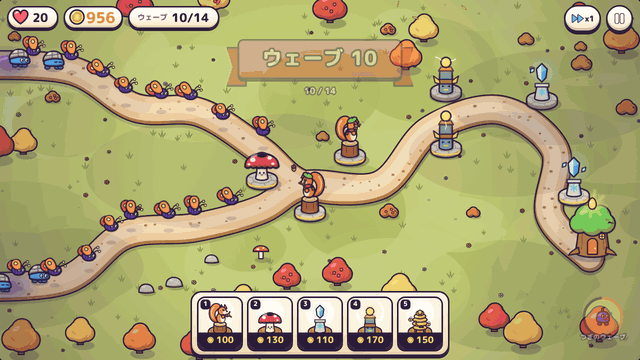
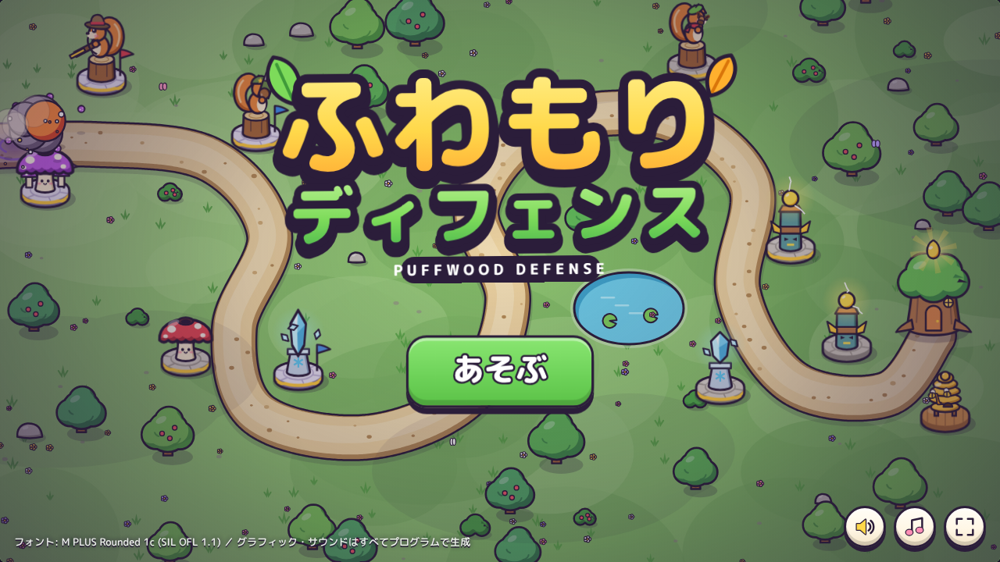
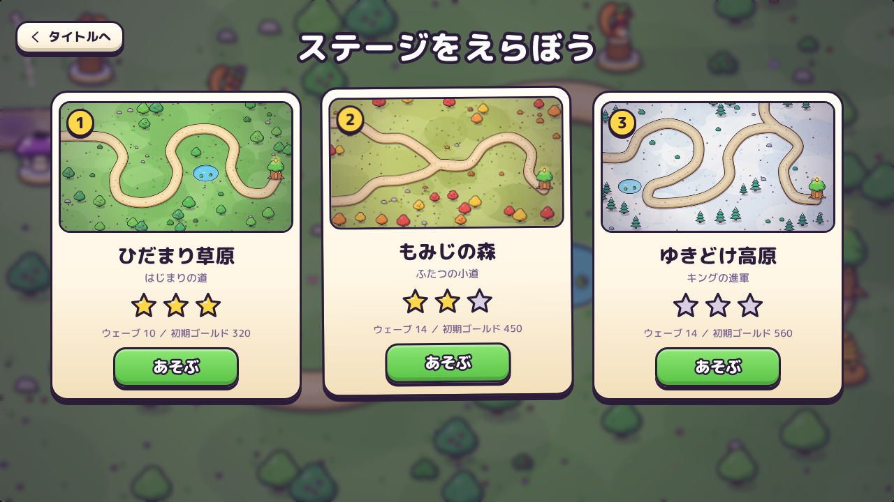
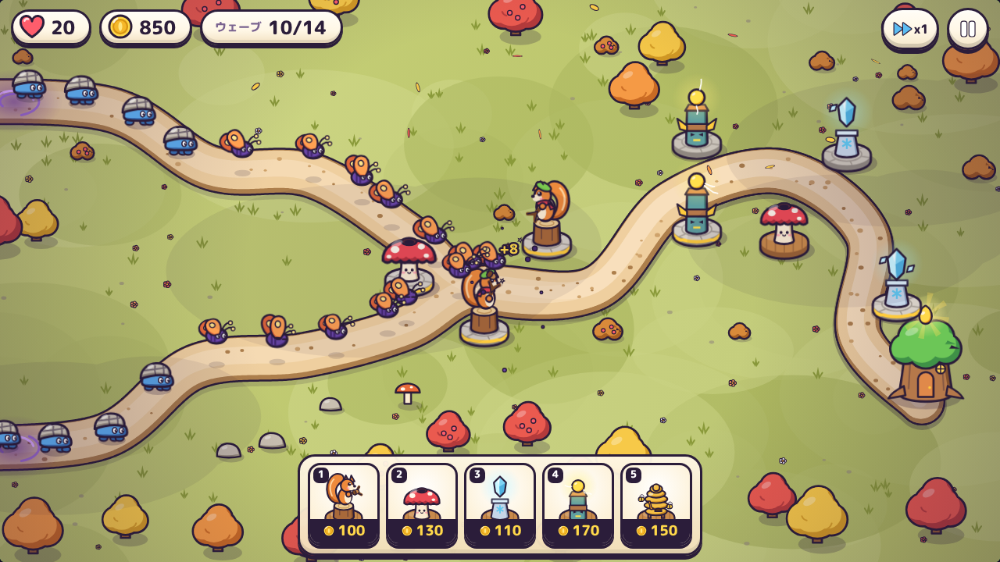
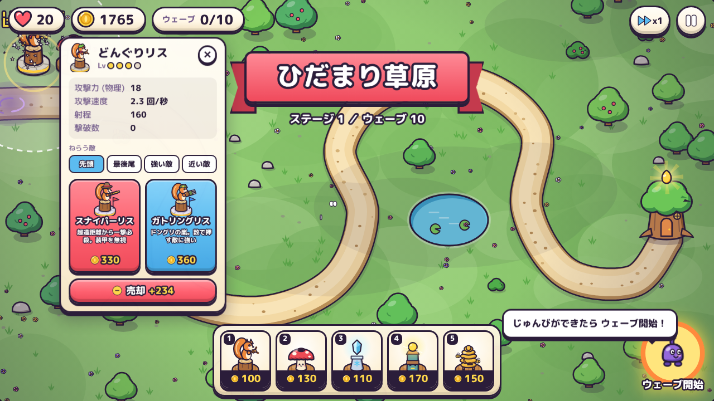
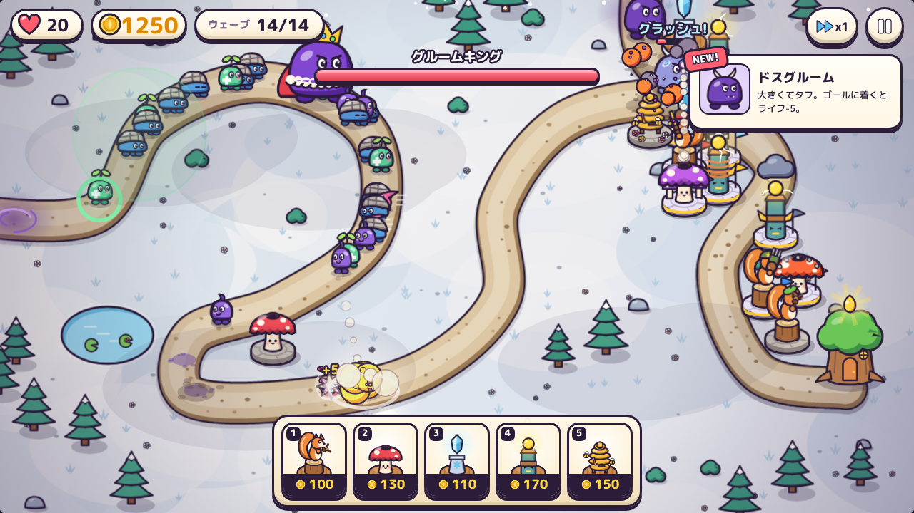

# ふわもりディフェンス（Puffwood Defense）

ブラウザで動く、カジュアルなタワーディフェンスゲームです。
インクのいたずら者「グルーム」たちから、森の家にある「ひだまりの種」を守ります。

**▶ ブラウザで遊ぶ: https://onego15.github.io/bloons-claude/**



| | |
|---|---|
|  |  |
| タイトル | ステージ選択 |
|  |  |
| もみじの森（道が2本） | 強化パネル（Lv3で最終形態を2択） |
|  | |
| ゆきどけ高原のボス戦 | |

## プロンプト一発で開発

このゲームは、AI（Claude）に下のプロンプトを**1回送っただけ**で作られました。途中で人間が指示や修正を出したり、質問に答えたりはしていません。企画、アート、実装、テスト、バランス調整、ブラウザでの画面確認と改善まで、AIが自分で進めています。

- **使ったLLM**: Claude Opus 5.5（Anthropic、モデルID `claude-opus-5-5`）
- **実行環境**: Claude Code（クラウド上のセッション）

ゲームの完成後に人間が出した指示は、git へのコミット、GitHub へのプッシュ、README へのスクリーンショット・プレイ動画・この説明の追加だけです。ゲームの中身には手を入れていません。

最初に送ったプロンプト（原文のまま）:

```text
Bloons TD 6やKingdom Rushのような、カジュアルで中毒性のあるタワーディフェンスゲームを制作してください。
ブラウザで快適に動作し、Steamで販売されている良質なインディーゲームのような、完成度の高いゲームを目指してください。
特に重視するのは、グラフィックの美しさ、統一されたアートスタイル、気持ちのよい攻撃演出、ゲームとしての面白さです。
主な要素：

* カラフルで親しみやすい、オリジナルの世界観
* 個性的なタワーと複数種類の敵
* タワーの配置、アップグレード、売却
* 徐々に難しくなるウェーブと戦略性
* 派手で気持ちのよい攻撃・撃破エフェクト
* 直感的で洗練されたUI
* 最初から最後まで遊べるゲーム進行

グラフィックについては、単純な図形を並べたプロトタイプや、AIが作ったとすぐ分かるような統一感のない素材の寄せ集めにはしないでください。
2D・3Dの選択、ゲームエンジン、プログラミング言語、アセットの制作・調達方法は自由です。必要に応じて、利用条件を遵守した公開アセットを使用して構いません。
コンテンツの量よりも、見た目・操作感・ゲーム性の完成度を優先してください。
私への途中確認や質問は不要です。
企画、設計、実装、素材準備、テスト、バグ修正、ビジュアルの改善まで、利用可能なツールの範囲で自律的に進めてください。
実際にブラウザでゲームを起動し、プレイ画面を確認して、見た目や操作性の問題を改善してください。
最終的には、ブラウザでプレイできる状態のゲーム一式と起動方法を提出してください。未実装・未検証の部分があれば正直に報告してください。
```

## 起動方法

どれか1つで遊べます。

0. **インストール不要**: https://onego15.github.io/bloons-claude/ を開く（GitHub Pages）。
1. **いちばん簡単**: `dist/puffwood-defense.html` をブラウザ（Chrome / Edge / Firefox / Safari）にドラッグして開く。フォントも含めて1ファイルにまとめてあります。
2. **フォルダ版**: `index.html` をダブルクリックで開く。
3. **ローカルサーバー**: このフォルダで `python3 -m http.server 8000` を実行し、`http://localhost:8000/` を開く。

インストールやビルドは不要です。音は最初にクリックした後から鳴ります（ブラウザの仕様）。

## 遊び方

- 下のショップからタワーを選び、道のそばをクリックして配置します（カードを地図へドラッグしても置けます）。
- 右下の丸いボタンでウェーブ開始。前のウェーブの出現が終わったら次を早めに呼べて、早いほどボーナスゴールドがもらえます。
- 置いたタワーをクリックすると、強化・売却（投資額の70%）・ねらう敵（先頭／最後尾／強い敵／近い敵）を選べます。
- Lv3まで強化すると、2種類の最終形態から1つを選べます。
- ライフが0になると負け。全ウェーブをしのぐとクリアで、残りライフに応じて星1〜3。クリアで次のステージが解放されます（進行はブラウザに保存）。

| キー | 操作 |
|---|---|
| 1〜5 | タワーを選ぶ |
| Space | 次のウェーブ |
| F | スピード切り替え（x1 / x2 / x3） |
| U | 選択中のタワーを強化 |
| P | ポーズ |
| Esc / 右クリック | 配置・選択のキャンセル |

スマホ・タブレットでは、カードをタップ → 置きたい場所を2回タップで配置します。

## 収録内容

- **ステージ3つ**: ひだまり草原（10ウェーブ）、もみじの森（14ウェーブ・道が2本）、ゆきどけ高原（14ウェーブ・ボス戦）
- **タワー5種**（各3レベル＋最終形態2択）
  - どんぐりリス（単体・連射）→ スナイパーリス / ガトリングリス
  - キノコ砲（範囲・地上のみ）→ ドカンダケ / ばくれつホウシ
  - しずくの祠（スロウ）→ ふぶきの祠 / つららの祠
  - カミナリ灯（連鎖する魔法攻撃）→ テスラ灯 / かみなり雲
  - ミツバチ農園（ウェーブごとに収入）
- **敵9種**: 基本・高速・装甲（物理に強い）・分裂・飛行（キノコ砲が当たらない）・魔法耐性・回復役・大型・ボス
- 初登場の敵の紹介、第1ステージのチュートリアルヒント、ボスの体力バー

## 技術メモ

- HTML5 Canvas 2D と素の JavaScript だけで作っています。外部ライブラリはありません。
- グラフィックは画像素材を使わず、すべてコードで描いています（太い輪郭線＋2色セル塗り＋左上からの光、という共通ルール）。描画済みのパーツは画面解像度に合わせてキャッシュして負荷を抑えています。
- 効果音と BGM は Web Audio API でその場で合成しています。
- フォントは M PLUS Rounded 1c（SIL Open Font License 1.1、`fonts/OFL.txt`）を、ゲームで使う文字だけに絞って同梱しています。

### フォルダ構成

```
index.html, style.css     フォルダ版の本体
js/                       util / data（タワー・敵・ステージ）/ art / audio / game / ui / main
fonts/                    サブセット済みフォントとライセンス
dist/                     1ファイル版
tools/                    開発用（バランス検証 sim.js、スクリーンショット・操作テスト、録画 record.js、ビルド）
screenshots/              README用の画像とプレイ動画
```

`tools/sim.js` は画面なしでゲームを自動プレイし、各ステージがクリア可能か・単調な戦略では負けるかを確認するスクリプトです（`node tools/sim.js`）。
